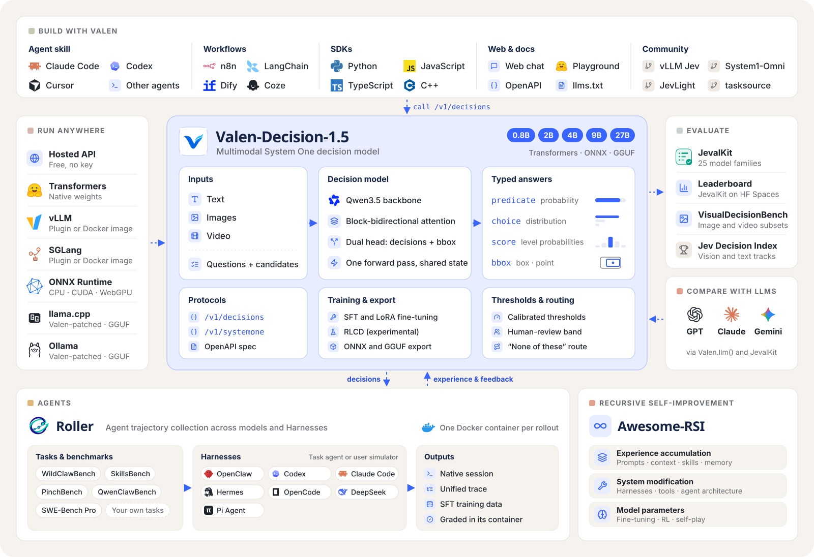

  <picture>
    <source media="(prefers-color-scheme: dark)" srcset="https://raw.githubusercontent.com/Valen-Team/.github/main/profile/assets/valen-ecosystem-dark.svg" />
    
  </picture>

<h1 align="center">Valen · 万澜</h1>

  <strong>Fast Decisions. Continuous Evolution.</strong> 
  Fast decision models · Recursive self-improvement (RSI) · Agents

  <strong>English</strong> · <a href="https://github.com/Valen-Team/.github/blob/main/profile/README_zh-CN.md">简体中文</a>

  <a href="https://valen-team.github.io/">Website</a> ·
  <a href="https://huggingface.co/spaces/Valen-Team/Valen-API">Playground</a> ·
  <a href="https://valen-team.github.io/docs/">Documentation</a> ·
  <a href="https://valen-team.github.io/news/">News</a> ·
  <a href="https://huggingface.co/Valen-Team">Hugging Face</a> ·
  <a href="https://huggingface.co/spaces/Valen-Team/JevalKit-Leaderboard">Leaderboard</a>

---

**Valen** is an open-source organization working on **fast decision models**, **recursive self-improvement (RSI)** and **agents**: models that decide quickly, agents that act on those decisions, and methods that turn experience into improvement.

## Projects

| Project | What it does |
| :--- | :--- |
| **[Valen-Decision](https://github.com/Valen-Team/Valen)** | Multimodal System One decision model, 0.8B to 27B. Text, images and video in; probabilities over your candidates out. [Try it](https://valen-team.github.io/) · [Models](https://huggingface.co/collections/Valen-Team/valen-decision-15) · [Docs](https://valen-team.github.io/docs/valen/) |
| **SDKs & integrations** | [Python](https://github.com/Valen-Team/valen-sdk-python), [JavaScript](https://github.com/Valen-Team/valen-sdk-js) and [C++](https://github.com/Valen-Team/valen-sdk-cpp) SDKs, an [agent skill](https://github.com/Valen-Team/skills) for coding agents, and [workflow integrations](https://github.com/Valen-Team/valen-integrations) for n8n, LangChain, Dify and Coze. |
| **[JevalKit](https://github.com/Valen-Team/JevalKit)** | Evaluation toolkit and [leaderboard](https://huggingface.co/spaces/Valen-Team/JevalKit-Leaderboard) for decision models. |
| **[Roller](https://github.com/Valen-Team/Roller)** | Agent trajectory collection across models and Harnesses, in disposable Docker containers. |
| **[Awesome-RSI](https://github.com/Valen-Team/Awesome-RSI)** | Papers, code, benchmarks and models on recursive self-improvement. |

## The name

Valen is named after evolutionary biologist **Leigh Van Valen**, who proposed the Red Queen hypothesis: keep adapting while everything around you evolves. Our Chinese name **万澜** (*Wàn Lán*) means countless waves, the wave-shaped **V** in our logo.

Contributions are welcome: open an issue or a pull request in any repository.
