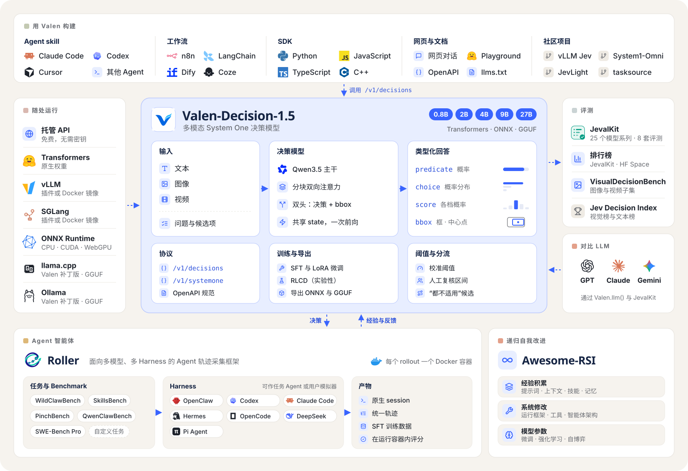

  <picture>
    <source media="(prefers-color-scheme: dark)" srcset="https://raw.githubusercontent.com/Valen-Team/.github/main/profile/assets/valen-ecosystem-zh-dark.svg" />
    
  </picture>

<h1 align="center">Valen · 万澜</h1>

  <strong>快速决策，持续进化。</strong> 
  快速决策模型 · 递归自我改进（RSI）· Agent 智能体

  <a href="https://github.com/Valen-Team/.github/blob/main/profile/README.md">English</a> · <strong>简体中文</strong>

  <a href="https://valen-team.github.io/">网站</a> ·
  <a href="https://huggingface.co/spaces/Valen-Team/Valen-API">在线体验</a> ·
  <a href="https://valen-team.github.io/docs/">文档</a> ·
  <a href="https://valen-team.github.io/zh-Hans/news/">动态</a> ·
  <a href="https://huggingface.co/Valen-Team">Hugging Face</a> ·
  <a href="https://huggingface.co/spaces/Valen-Team/JevalKit-Leaderboard">排行榜</a>

---

**Valen · 万澜**是一个开源组织，关注**快速决策模型**、**递归自我改进**（RSI）与 **Agent 智能体**：模型快速做出决策，Agent 依据决策行动，RSI 方法把经验转化为改进。

## 开源项目

| 项目 | 简介 |
| :--- | :--- |
| **[Valen-Decision](https://github.com/Valen-Team/Valen)** | 多模态 System One 决策模型，0.8B 至 27B。输入文本、图像和视频，输出给定候选的概率。[在线体验](https://valen-team.github.io/zh-Hans/) · [模型](https://huggingface.co/collections/Valen-Team/valen-decision-15) · [文档](https://valen-team.github.io/zh-Hans/docs/valen/) |
| **SDK 与集成** | [Python](https://github.com/Valen-Team/valen-sdk-python)、[JavaScript](https://github.com/Valen-Team/valen-sdk-js) 和 [C++](https://github.com/Valen-Team/valen-sdk-cpp) SDK，面向编程 Agent 的 [Agent skill](https://github.com/Valen-Team/skills)，以及 n8n、LangChain、Dify 和 Coze 的[工作流集成](https://github.com/Valen-Team/valen-integrations)。 |
| **[JevalKit](https://github.com/Valen-Team/JevalKit)** | 决策模型评测工具与[排行榜](https://huggingface.co/spaces/Valen-Team/JevalKit-Leaderboard)。 |
| **[Roller](https://github.com/Valen-Team/Roller/blob/main/README_zh-CN.md)** | 面向多模型、多 Harness 的 Agent 轨迹采集框架，在一次性 Docker 容器中运行。 |
| **[Awesome-RSI](https://github.com/Valen-Team/Awesome-RSI/blob/main/README.zh-CN.md)** | 递归自我改进相关的论文、代码、基准与模型合集。 |

## 名字的由来

**Valen** 得名于提出红皇后假说的进化生物学家 **Leigh Van Valen**：周围的物种不断进化，生物也必须持续适应。中文名**万澜**（*Wàn Lán*）寓意万千波澜，标志中波浪形的 **V** 由此而来。

欢迎在任意仓库提交 Issue 或 Pull Request。
